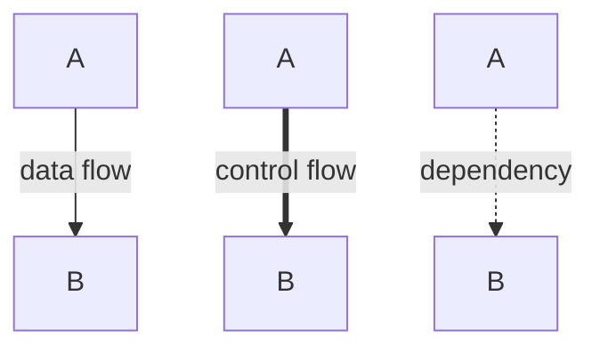
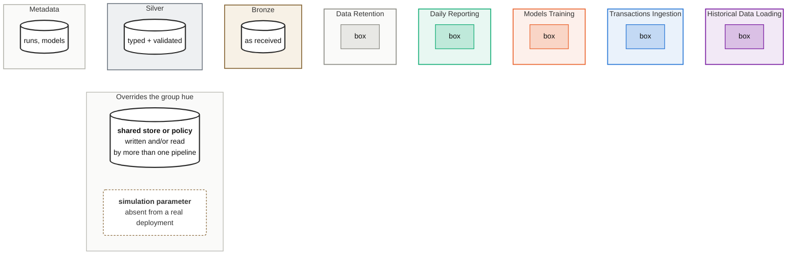
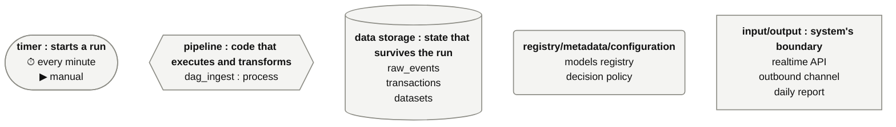

###### Links

###### Colors

Three families of group, and two node styles that override the group hue.

| Family | Treatment | Why |
|---|---|---|
| **Pipelines** carrying transaction data | one of four validated hues | they are the actors |
| **Data layers** | neutral, warm *vs* cool | they are a substrate, not an actor |
| **Cross-cutting groups** | neutral grey, most recessive | they belong to no pipeline |

`Data Retention` is a pipeline, yet it is shown neutral: the four hues are reserved for the
pipelines that carry transaction data, and a fifth hue would fail colour-vision validation.

> Bronze, Silver and Metadata hold shared elements only, so no box inside them carries a group
> hue : **coloured = belongs to one pipeline · white = crossed by several**.
> The four hues were validated for colour-vision deficiency (worst pair ΔE 9.2 in deuteranopia,
> 21.5 in normal vision). Group titles always name the group, so colour never carries the
> information alone.

###### Shapes

